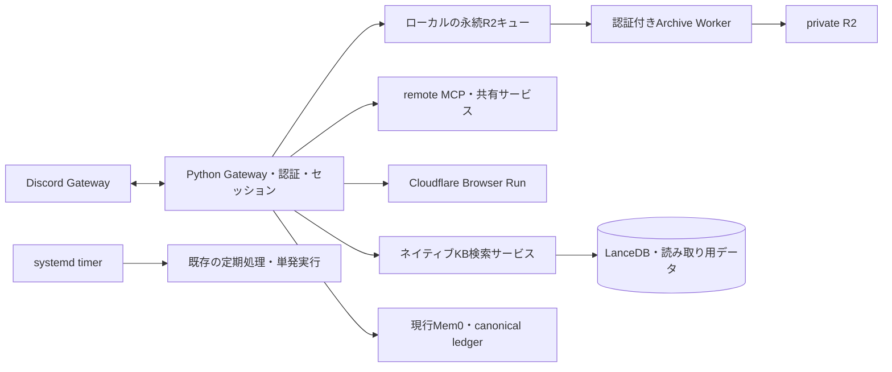

# Discord Botの処理分離設計と実装記録。

常駐Gateway、認証・セッションを管理する制御処理、CPU・メモリを消費する実行処理、永続データを別々に配置する構成を採用します。まずR2転送、投資知識検索、MCP接続、数式描画、定期実行を分離可能にしました。記憶ストアの全面移行とGatewayの全面移設は、データ移行・権限・再実行の検証を伴う後続工程として設計しました。

この変更は実装とローカル検証までです。本番環境変数、稼働サービス、Cloudflareアカウント、既存データは切り替えていません。

## 走査範囲と現状の根拠。

- `git ls-files --cached --others --exclude-standard`を起点に、Python全ファイルをASTで走査しました。約14万行を対象に、import、プロセス起動、バックグラウンド実行、ストレージ操作、全件読み込みを分類しました。アプリケーション部分は約6.7万行です。個別ファイル・参照行・依存関係は[走査台帳](offload-inventory-2026-09-09.json)に記録しています。静的な検出件数は負荷測定値ではありません。
- 実行経路は`main_async.py`、`bot.py`、`bot_pipeline/`、`services/providers/`、`services/claude_api/`、`services/codex_app_server/`を確認しました。記憶・検索は`services/mem0/`、`services/invest_kb/`、保存・運用は`services/session*`、`services/r2_archive.py`、描画・添付は`utils/`、定期処理・デプロイは`scripts/`、`deploy/`、`infra/`を確認しました。
- 既存の7月のオフロード計画とアカウント移植記録を照合しました。外部Workerのソース配置は`/home/ubuntu/projects/kanae-cf-workers`に存在します。この作業で同ディレクトリの既存Workerを更新していません。
- 実機のsystemdメモリ、プロセスRSS、ホストのMemAvailable・PSIを読み取りました。秘密値、会話本文、データベース内容は台帳へ記録していません。
- 実行中に別の変更が存在していました。設定・サービス定義・MCP選択処理等の既存変更を保持しています。

初回観測では`discord-bot.service`が約437MiB、`discord-bot-kanae-claude.service`が約320MiB、ChromaDBが約249MiBでした。MemAvailableは約4.4GiBでした。後続観測ではBotのcgroupが1.2GiB程度まで増えています。cgroupには子プロセスやこの作業に伴う実行が含まれ得るため、定常負荷と解釈しません。Swap使用量だけから現在のスラッシングも断定しません。

| 発見箇所 | 確認した現状と設計への影響です。 |
| --- | --- |
| `services/r2_archive.py` | 通常の履歴・画像まで1オブジェクトごとにWranglerを起動します。HTTP接続の再利用でNode起動を減らせます。 |
| 同ファイルのflush | バッチ件数を絞った後にbackoffを判定するため、先頭の再試行待ちで後続が進まない構造でした。同じキーの古い再試行にも順序制御が必要でした。 |
| 同ファイルのstate scan | 除外ディレクトリも`rglob`で訪問してから除外していました。キューを走査する無駄を削減しました。 |
| `services/invest_kb/__init__.py` | 検索のimportで書き込みAPIもimportし、PyArrowとNumPyが読み込まれていました。遅延読み込みへ変更しました。 |
| `services/invest_kb/search.py` | 検索結果をPandasへ変換し、使用しないベクトル列も展開していました。必要列を選択し、辞書で受け取る形へ変更しました。 |
| `utils/math_renderer.py` | 数式はローカルKaTeXとChromiumです。以前のCloudflare化の後、Quick Actionsのレート制限を理由にローカルへ戻されています。既存資料の「数式も移管済み」は現行コードと一致しません。 |
| `config/__init__.py` | 多数のMCPがローカルstdio起動です。共有HTTP・Workers・事業者提供MCPに接続先を変更できる共通境界を追加しました。 |
| `services/mem0/integrity.py` | canonical ledger、outbox、世代、lease、projection watermark、migration coverageが存在します。記憶を単純なHTTP CRUDへ置き換えるとこれらの整合性保証が失われます。 |
| `services/mem0/__init__.py` | Mem0αのmodule aliasとlegacy経路があります。ストア移行は実効モードごとの検証が必要です。 |
| 複数BotのR2設定 | `BOT_STATE_DIR`を分けても、R2 prefixの既定値は共通です。切替時はBotごとのprefixとWorkerを明示し、`state/latest`の衝突を防止します。稼働設定で衝突が発生したことまでは確認していません。 |
| 定期実行 | VIと介入監視は待機用Pythonプロセスを常駐させています。単発実行とsystemd timerを追加しました。数MiB級の定常削減と実行時間制限が主な効果です。 |

## 費用対効果を比較した32案。

優先度Aは現在の構造で実施する案です。Bは検証後に展開する案です。Cは複数台運用・再起動耐性等を目的に大きく設計変更する案です。費用は実装工数と運用複雑性も含めて評価しています。

| 番号 | 優先度 | 案と対象 | 効果・条件・実装状態です。 |
| --- | --- | --- | --- |
| 01 | A | R2転送を認証付きWorkerへ移します。 | 通常オブジェクトのWrangler起動を除去します。Worker・Python接続・CIを実装しました。64MiB超は既存CLIを使用します。 |
| 02 | A | R2キューに公平な受付と同一キー順序を導入します。 | backoffによる全体停止と旧snapshotの遅延上書きを抑止します。実装しました。 |
| 03 | A | バックアップ走査からspoolとscratchを枝ごと除外します。 | キュー件数に比例する不要なディレクトリ訪問を減らします。実装しました。 |
| 04 | A | 重量級ライブラリを必要時に読み込みます。 | 未使用のKBでPyArrow・NumPyを読み込みません。実装しました。 |
| 05 | A | 投資KBのネイティブ検索を専用VM・コンテナへ移します。 | LanceDB・Arrow・検索CPU・ページキャッシュをGatewayホストから移せます。HTTPサービス、クライアント、コンテナを実装しました。 |
| 06 | A | 検索の複数query・2ベクトル列をまとめ、不要列を除きます。 | ネットワーク往復とベクトルのPython展開を減らします。ローカルとリモートの双方へ実装しました。 |
| 07 | A | MCPのremote transportを共通設定にします。 | stdio・npx起動を接続先単位で廃止できます。元の権限tierを維持する設定処理を実装しました。 |
| 08 | A | 数式描画先を選択可能にします。 | Cloudflare選択時にローカルChromiumを起動しません。失敗時の文字出力、既存ローカル経路、キャッシュ分離を実装しました。 |
| 09 | A | 待機schedulerをsystemd timerへ置換します。 | 常駐2プロセスを不要にし、子プロセスを含む実行時間上限を設定できます。`--once`とtimer・drop-inを実装しました。 |
| 10 | A | 分離構成のビルド・検証・負荷台帳を再現可能にします。 | 外部サービスの属人的な再実装を避けます。Workerの型生成・テストCI、native用Dockerfile、走査スクリプトを実装しました。 |
| 11 | B | 大容量R2転送もS3 multipartへ移します。 | 64MiB超に残るCLI起動を除去します。abort・中断復帰・同一キーの世代管理が追加要件です。今回の通常転送とは別工程です。 |
| 12 | B | 古いJSONLをR2の日次圧縮オブジェクトへ集約します。 | ファイル件数、ローカル容量、一覧操作を減らします。`load_api_replay_channel`が使う現行セッションはローカルに保持します。 |
| 13 | B | Browser bindingを使う描画WorkerにKaTeXとフォントを同梱します。 | 外部CDN待機を減らし、テンプレート単位の画像キャッシュも共有できます。Quick Actionsの制限と画質を実測して移行します。 |
| 14 | B | Playwright MCPをCloudflare Browser Runへ移します。 | Bot本体以外のブラウザ起動も削減できます。remote設定は実装済みです。ツール名、セッション継続、ファイル操作の互換性を先に確認します。 |
| 15 | B | Context7・Tavilyを提供元のremote MCPへ接続します。 | 自作プロキシを運用せずnpxを削減できます。今回の設定境界で接続可能です。現行ツールschemaとの一致が切替条件です。 |
| 16 | B | Nikkei・Polymarket・みんかぶ等をAPI別Workerへ移します。 | Python MCP起動とHTTP取得の重複を削減します。純粋な取得・変換は適性があります。金融指標の計算結果・時刻・出典・egress制限の確認が必要です。 |
| 17 | B | X・不動産等のスクレイパーを専用実行VMへ移します。 | ブラウザ・解析プロセスを隔離できます。接続元IPやCookieを検証し、共有Gatewayへ巻き戻さない障害設計にします。 |
| 18 | B | ChromaDBを専用VMまたは管理型ストアへ移します。 | 現在のChromaDB常駐分をホストから移せます。TLS・認証・ネットワーク遅延、backup/restore、実効Mem0 providerの対応を検証します。 |
| 19 | B | Mem0の検索・書き込み・日本語解析を一つのサービスへ集約します。 | BotごとのSDK・辞書・索引の重複を削減します。現行ledger/outboxとOAuth補助呼び出しを含む境界が必要です。単にChromaの接続先を変える案より効果があります。 |
| 20 | C | canonical factsをD1、ベクトルをVectorizeへ移します。 | Gatewayから記憶DBを除き、再構築可能な検索projectionへ分離します。世代付きoutbox、ユーザー隔離、削除済みfactの再出現防止を必須にします。 |
| 21 | C | BM25・履歴FTSを検索サービスまたはD1へ移します。 | 多Botの共有検索には効果があります。単一Botでは往復が増えます。日本語の前処理とFTS rankingを同じ入力で比較します。 |
| 22 | B | 記憶の抽出・保守・再索引をQueuesへ送ります。 | 長い背景処理をGatewayから分離し、停止中も処理できます。既存work_itemsのlease・cursor・DLQを移植します。 |
| 23 | C | Deep ResearchをWorkflowsで永続化します。 | 再起動後の調査再開と途中成果物の保存を可能にします。ユーザー承認、キャンセル、予算、出典台帳をステップ境界にします。 |
| 24 | B | APIキーを使用する補助LLM呼び出しをWorkerへ移します。 | rewrite・rerank・分類のtimeout・観測・cacheを集約します。主な効果は運用分離です。認証方式を変える場合はLLM料金も再試算します。 |
| 25 | B | コード実行を専用VM・コンテナ実行基盤へ移します。 | CLI、テスト、ビルドのCPU・RAMスパイクをGatewayから隔離できます。workspace同期、成果物回収、強制終了、秘密情報の範囲を設計します。 |
| 26 | A | 開発用Codex・テスト環境をBotホストから分離します。 | 複数CLIとテストの同時負荷を分離でき、実測上の改善余地があります。クラウド関数の細分化より先に比較する価値があります。今回は作業環境を移設していません。 |
| 27 | B | ローカルMCPの共有サービスを整理します。 | SDK・stdio子プロセスの重複を減らせます。既存supergateway patchを含め、session終了後の子プロセス回収を検証します。 |
| 28 | C | セッション・job・レート制限をDurable Objectsへ移します。 | Gateway複数台化に必要なチャンネル単位の直列実行を提供します。小さなJSONだけを移す場合のRAM削減は限定的です。 |
| 29 | C | Gatewayを最小のWebSocket受信・Discord送信プロセスにします。 | 状態・ツール実行・検索を外部化した後の到達点です。イベント順序、resume、重複配送、`/abort`の伝播を維持します。 |
| 30 | C | 対象機能をDiscord InteractionsのHTTP受付へ変更します。 | slash command中心の機能はWorkerで受けられます。通常メッセージの監視とメンション会話は別のGateway処理が必要です。 |
| 31 | B | 観測・費用・ソース管理をCloudflare側へ集約します。 | Worker別CPU、Browser時間、R2 backlog、native query時間を同じrun IDで追跡します。外部Workerソース・lockfile・設定を一緒に管理します。 |
| 32 | A | ホストの容量追加と分離案の実測比較を行います。 | 開発工数も含めて選択します。MemAvailable、PSS、memory PSI、OOM、返信p95を一週間測定し、容量追加の予算と比較します。 |

## 切替後の構成です。

数式・KB・Archiveの切替は独立した設定です。障害時にKBが空のローカルDBへ自動接続したり、remote描画が無断でChromiumを起動したりしないようにしています。R2は確定ACKを得るまでspoolを残します。書き込み済み・ACK消失は再試行可能です。異なるBotは別prefixで運用します。

KBの境界は検索のネイティブ部分です。元のOpenAI embedding、Haiku rewrite/HyDE、RRF、noise gate、rerank、出典整形は既存パイプラインに残しています。モデル、1536次元、cosine距離、2つのvector列を維持しています。現行コーパスを再埋め込みせずに移せます。移行先のKB更新は取り込み側で行い、HTTPサービスには書き込み・削除APIを設けていません。

## 費用の目安です。

2026-09-09に公式資料を確認しました。米ドル・月額を使用し、税・為替・他用途による無料枠消費を含めません。既存アカウントの使用量と請求額は取得していません。

| 構成 | 料金の根拠と今回の試算です。 |
| --- | --- |
| Workers | Paidの基本額は$5、1,000万requestと3,000万CPU-msが含まれます。超過は100万requestあたり$0.30、100万CPU-msあたり$0.02です。月14万request・平均5msならこの枠内です。既契約なら基本額を重複計上しません。[公式料金](https://developers.cloudflare.com/workers/platform/pricing/)です。 |
| R2 | Standardは$0.015/GB-month、Class Aは$4.50/100万、Class Bは$0.36/100万です。30GB・12万PUT・同数HEAD・2万GETを想定すると、無料枠適用前の比例計算は$1.0404です。実請求には無料枠と課金単位の丸めが適用されます。保存済みデータを二重に計上しません。[公式料金](https://developers.cloudflare.com/r2/pricing/)です。 |
| Browser Run | Paidは10時間/月が含まれ、超過は$0.09/時間です。1日1,000画像・1画像2秒・30日なら約16.7時間で、時間課金の超過は約$0.60です。再試行・ページ待機を含む実稼働時間で変わります。[公式料金](https://developers.cloudflare.com/browser-run/pricing/)です。 |
| Native KB | 専用VMの月$10〜30を選定用の予算枠とします。既存の別VMへ同居できれば追加費用は下がります。Cloud Runを選ぶ場合はCPU・メモリ・稼働時間とデータ配置を計算します。[Cloud Run料金](https://cloud.google.com/run/pricing)です。 |
| Queues | Paidは100万操作/月が含まれ、超過は$0.40/100万操作です。通常の1メッセージは書き込み・読み取り・削除の3操作で、再試行も消費します。[公式料金](https://developers.cloudflare.com/queues/platform/pricing/)です。 |
| Vectorize | query次元と保存次元に課金されます。Paidはquery次元5,000万/月と保存次元1,000万が含まれます。1536次元×query variants×実際のquery数で試算します。embeddingのモデル料金は別です。[公式料金](https://developers.cloudflare.com/vectorize/platform/pricing/)です。 |
| D1 | 行の読み書きと保存容量に課金されるため、全表走査を移すだけでは費用が増えます。tenant・user・status索引を先に設計します。[公式料金](https://developers.cloudflare.com/d1/platform/pricing/)です。 |

上記条件なら最初の展開予算は追加$5〜40/月程度です。これは運用枠の提案です。LLM料金の変化、開発用VM、バックアップ追加容量は別に見積もります。単価よりも、本番Gatewayとビルド・ブラウザ・索引処理の負荷分離を優先します。

## 大きな設計変更の条件です。

- Workersの通常実行環境にはメモリ・CPU・実行モデルの制約があります。ネイティブLanceDBや任意のCLIをそのまま移す対象には選定していません。今回のKBはVM・コンテナ用です。[Workers limits](https://developers.cloudflare.com/workers/platform/limits/)です。
- Durable ObjectsのWebSocket hibernationはserver側の接続が対象で、outbound WebSocketは対象外です。Discord Gatewayを置くだけで休止課金になるとは見積もりません。[WebSockets](https://developers.cloudflare.com/durable-objects/best-practices/websockets/)です。
- Cloudflare Containersのディスクはephemeralです。現行`.state`をそのまま置く構成では永続性を確保できません。読み取り専用KB snapshotを起動時取得する構成は候補です。[Container lifecycle](https://developers.cloudflare.com/containers/concepts/architecture/)です。7月の特定バグが現在も続いているとの断定は採用していません。
- Vectorizeのmetadata indexは最大10個です。全metadataをそのまま検索条件へ移す設計は採用しません。tenant/user/channel/visibility/status/version等を選定し、本文・関係・履歴をcanonicalストアへ残します。[metadata filtering](https://developers.cloudflare.com/vectorize/reference/metadata-filtering/)です。
- Queuesはat-least-once配送です。保存・通知をexactly-onceと解釈せず、event ID・世代・処理済み記録を使います。[delivery guarantees](https://developers.cloudflare.com/queues/reference/delivery-guarantees/)です。
- Workflows化では各ステップに再実行可能性と外部副作用の冪等性が必要です。現在のResearchRunのcancel・cleanup・ユーザー承認をステップに写す工程が必要です。[Workflows rules](https://developers.cloudflare.com/workflows/build/rules-of-workflows/)です。
- Browser Runにはrequest数・concurrency・timeoutの制限があります。数式は少量のcanaryから開始し、レート制限で文字出力へ退避した割合を計測します。[Browser limits](https://developers.cloudflare.com/browser-run/limits/)です。

Mem0の抜本移行では、まずledgerのcoverageを検証し、snapshotとevent cursorを固定します。その後に同じID・versionで新projectionを構築し、追随イベントを反映します。削除・merge・scope変更を含むshadow検索で同一ユーザーの検索品質を比較します。canonical ledgerのversion確認で古いprojectionを除外し、対象Botを限定して読み先を切り替えます。戻す場合は未反映イベントを失わず旧projectionへ追随させます。現在のMem0α alias経路とlegacy/canonical経路は別々に合格させます。

## 検証と移行順序です。

単独KB importの3回測定では、RSS中央値が62,500KiBから20,096KiBへ減少し、約41.4MiBの差がありました。PSS中央値は29,920KiBから11,420KiBへ減少しました。import時間中央値は約0.320秒から0.131秒でした。[測定データ](offload-import-benchmark-2026-09-09.json)を保存しています。他機能が同じライブラリを読み込む本番Botへ、この差をそのまま加算しません。

認証・namespace拒否・checksum・ACK消失・再試行・既存R2オブジェクトの読み取りはWorker実行環境で検証しました。実LanceDBとloopback HTTPで順位・metadataの一致を検証しました。キャンセル後もネイティブ処理が完了するまで受付枠を保持することを確認しました。専用Dockerイメージをビルドし、512MiB制限・読み取り専用rootとKBマウントで実検索と認証拒否を確認しました。Pythonのunit lane、contract lane、対象integration、Ruff、対象Mypy、Worker型検査を実施しました。結果の詳細は[導入手順](../deploy/offload/README.md)に記録しています。

展開順序は、R2のテストprefix、KBの読み取り用コピー、少量の数式描画、MCP単位のschema確認、timerへの単独切替です。それぞれの切替後にbacklog・error・p95とメモリを測定します。VIの旧WorkerとPython処理ではデータソース・価格調整の違いが記録されているため、計算内容を変更せずに済むtimer化を先行します。

本番切替の合格条件は、履歴・添付の欠落ゼロ、tenant混在ゼロ、固定コーパスの検索品質維持、OOMゼロ、R2 backlogの解消です。追加ネットワークによるKB検索p95の増分目標を150ms以内、返信全体p95の悪化目標を5%以内とします。これらは設計上の受入目標で、今回測定した本番値ではありません。
